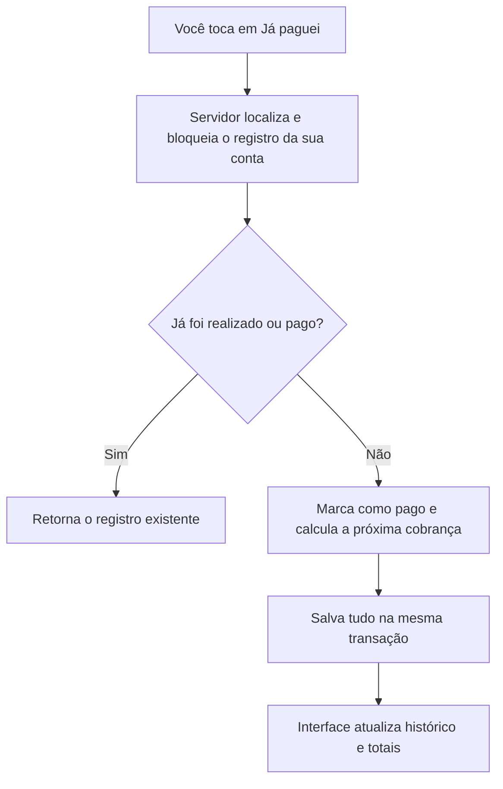

# Revisão e correções — 11/10/2026

## Onde as mudanças foram feitas

As correções estão na pasta `nexus-finance-publish`, a versão mais completa inspecionada. `deploy` e `repair` são outras áreas de trabalho do mesmo Git e não receberam essas alterações. Nenhum commit, push, deploy ou alteração de dados reais foi realizado nesta revisão.

Foram revisados os fluxos do JavaScript, os elementos HTML correspondentes, gráficos, autenticação, validação, movimentações, metas, consultas Binance, migrações, cache do aplicativo e arquivos de publicação/testes. Os arquivos históricos de `audit_snapshot` e o Apps Script antigo não são executados pelo fluxo atual do site e foram preservados.

## O que foi corrigido e por quê

### 1. Login e sessão

- **Alternar login/cadastro quebrava o botão.** A troca de texto apagava os elementos internos de animação e legenda. Agora apenas a legenda é alterada. Isso também corrige entrar novamente depois de sair.
- **Era possível enviar o login durante a verificação inicial ou trocar de modo durante o envio.** Os controles aguardam a conclusão da operação, evitando pedidos concorrentes que poderiam se anular.
- **Mensagens usavam códigos técnicos mesmo quando a API enviava uma explicação.** A interface prioriza a mensagem e mostra textos em português para credenciais incorretas, cadastro restrito e excesso de tentativas.
- **Uma resposta atrasada podia repor dados na memória após sair.** Pedidos de dados verificam se a sessão local mudou antes de entregar a resposta ao restante da interface.
- **Sair não limpava a carteira Binance nem o estado visual de edição.** A limpeza agora inclui esses elementos e interrompe o monitor periódico de mercado.
- **Trocar uma senha com acentos podia causar erro no servidor.** A comparação segura agora usa bytes UTF-8. A comparação de e-mail autorizado recebeu o mesmo ajuste.

A exigência de login a cada abertura/recarga foi mantida: está expressamente descrita como uma escolha de privacidade no projeto. A documentação do iPhone, que prometia entrada automática, foi corrigida.

### 2. Gravação de movimentações e metas

- **O banco podia salvar, mas a tela mostrar erro.** Após aguardar a resposta, o código tentava acessar `event.currentTarget`, que o navegador já havia limpo. Agora o formulário é guardado antes da espera e reiniciado corretamente.
- **Cliques repetidos podiam enviar o mesmo formulário duas vezes.** O envio bloqueia o botão até terminar, tanto em movimentações quanto em metas. Isso bloqueia duplicação por cliques concorrentes; não equivale a uma garantia de idempotência para todo POST em caso de falha de rede.
- **Editar uma conta paga a tornava pendente novamente.** Ao editar no mesmo tipo de lançamento, o status realizado/pago e a data de pagamento são preservados.
- **Editar renda fixa repetia taxa e vencimento nas observações.** Os campos estruturados são separados das observações livres antes da edição, evitando acrescentá-los novamente.

### 3. Pagamentos, parcelas e assinaturas

Antes, o navegador enviava um pedido para marcar como pago e outro para criar a próxima parcela. Uma falha entre os pedidos deixava o resultado incompleto, e cliques concorrentes podiam duplicar parcelas.

Agora o servidor bloqueia o registro durante a operação e faz a baixa e a criação da próxima cobrança na mesma transação PostgreSQL. Uma falha impede a confirmação do conjunto. Repetir a operação de um registro já pago não cria outra parcela nem muda sua data de pagamento.



Também foram corrigidos:

- **Assinaturas:** passam a gerar a próxima cobrança conforme a recorrência.
- **Última parcela:** um parcelamento finito não recomeça depois da última parcela.
- **Fim do mês:** um vencimento no dia 31 usa o último dia disponível de fevereiro e retorna ao dia 31 no mês seguinte, quando possível.
- **Ano bissexto:** recorrência anual em 29/02 usa 28/02 em um ano sem esse dia.
- **Data de pagamento:** usa o fuso `America/Sao_Paulo` no banco.
- **Versões antigas:** precisam atualizar antes de pagar. A API exige `atomicPayment: true`, impedindo que o navegador antigo também gere uma parcela depois de o servidor já a ter criado.

Não foram apagadas ou corrigidas automaticamente duplicatas históricas. Isso exigiria analisar os dados reais e identificar quais registros representam a mesma obrigação.

### 4. Totais e histórico

- **Renda fixa não era descontada do saldo disponível.** O saldo agora considera todas as saídas realizadas. Exemplo: entrada de R$ 1.000 e aporte de R$ 200 resultam em saldo de caixa de R$ 800. Os mesmos R$ 200 aparecem no indicador de investimentos, sem uma segunda dedução.
- **Assinaturas eram omitidas de pendências e lembretes.** Foram incluídas no total pendente, na lista de vencimentos, no lembrete e no gráfico correspondente. Registros realizados não são tratados como pendentes.
- **Investimentos tinham critérios diferentes entre painéis.** O total mensal usa a mesma identificação de investimentos da aba específica, incluindo o modo Renda Fixa.
- **Percentuais negativos eram limitados a -100%.** A taxa agora mostra o resultado efetivamente calculado quando as saídas ultrapassam muito a renda.
- **Histórico parava em 80 registros.** Há um botão “Carregar mais” para acessar os registros seguintes. Trocar o filtro ou a busca reinicia a quantidade exibida.

### 5. CSV, relatório e notícias

- **CSV:** campos com ponto e vírgula, aspas ou quebras de linha são protegidos corretamente. Textos que podem ser interpretados como fórmulas recebem um prefixo de texto ao exportar.
- **Impressão:** se o navegador bloquear a janela, aparece uma mensagem. O pedido de impressão é iniciado pelo código autorizado da página, sem depender de um script embutido no relatório que poderia ser bloqueado pela política de segurança.
- **Notícias:** links externos aceitam apenas os protocolos HTTP e HTTPS. Escapar texto HTML, sozinho, não validava o protocolo da URL.

### 6. Binance e validações do servidor

- **Binance:** usa o mesmo tratamento de timeout, erros e sessão das outras consultas; limpa valores antigos antes de uma nova consulta e ao sair.
- **Saldos inválidos:** respostas negativas ou não finitas, como `NaN` e `Infinity`, são descartadas. A filtragem usa decimais para evitar conversões desnecessárias para ponto flutuante.
- **Meta com objetivo zero:** é rejeitada também em uma atualização parcial, antes de provocar erro de restrição no banco.
- **Parcela atual maior que o total:** é rejeitada quando os dois campos são informados na validação.
- **Identificador fora do limite do banco:** retorna erro de entrada, em vez de chegar ao PostgreSQL como um inteiro impossível de armazenar.
- **Conexão PostgreSQL:** recebeu limite de dez segundos para estabelecer a conexão. Esse limite não controla a duração de cada consulta SQL.

### 7. Publicação e aplicativo instalável

- **O build extraía um ZIP divergente e podia substituir o código atual.** O serviço existente ainda extrai o ZIP; o pacote foi recriado com os arquivos atuais e a CI agora verifica que cada arquivo corresponde à fonte. O `render.yaml` usa diretamente o checkout apenas para novos serviços.
- **Um workflow recriava o ZIP e fazia commits automáticos.** Foi convertido em verificação manual e disponibilização do pacote versionado como artefato, sem escrever no repositório.
- **Os testes CI ainda começavam pelo ZIP antigo.** Agora montam a verificação diretamente dos arquivos atuais e executam também os testes JavaScript. O workflow de verificação cobre pushes e pull requests.
- **Cache:** a versão dos recursos foi alterada para `20261011-audit1`, permitindo que o aplicativo instalado detecte os arquivos novos.
- **Notificações:** não afirmam mais que a atualização já foi instalada quando apenas detectaram uma versão nova. O acesso à API de notificações verifica se ela existe, e o service worker ativo trata o clique para abrir/focar o aplicativo.

O ZIP versionado precisa ser atualizado junto com as fontes pelo comando `python tools/build_deploy_package.py`. Frontend e backend desta revisão devem ser publicados juntos. O comando remoto do serviço existente ainda extrai o ZIP; mudar o `render.yaml` localmente não modifica essa configuração no painel.

## Como foi verificado

- Testes Python existentes e regressões novas, sem conexão a banco real.
- Testes do JavaScript real em um ambiente com DOM simulado: inicialização, login/cadastro, CSV, links, impressão bloqueada, histórico, cálculos, formulários, edição de conta paga, envio duplicado e resposta após logout.
- Teste em Chrome headless com perfil temporário e API local fictícia: alternar cadastro/login, entrar, salvar movimentação com envio duplo, limpar formulário, criar meta, sair e entrar novamente. Foram observados erros e rejeições JavaScript.
- Compilação/análise de sintaxe dos scripts e execução das verificações Python de segurança existentes no workflow.
- `git diff --check` para verificar problemas de formatação do diff.

Comandos para repetir a parte automatizada, na raiz de `nexus-finance-publish`:

```powershell
python -m unittest discover -s backend/tests -t .
node tests/frontend-regression.cjs
python tests/browser_smoke.py --browser "C:/Program Files/Google/Chrome/Application/chrome.exe"
```

O terminal desta máquina não tem `node` no PATH; os testes JavaScript foram executados pelo runtime Node disponível nas ferramentas. No GitHub Actions, o workflow instala Node 22.

## Limites desta revisão

O teste de navegador usa uma API fictícia e exclui a dependência externa de gráficos para verificar o comportamento sem ela. Não comprova integração real com PostgreSQL, autorização de produção, gráficos carregados pelo CDN ou APIs externas. A lógica transacional foi exercitada com mocks; bloqueios, rollback e migrações ainda precisam de um teste com PostgreSQL real.

Também faltam a validação do Blueprint pela CLI do Render, que não está disponível neste ambiente, e testes de atualização/instalação em dispositivos móveis reais. O comando de build do serviço publicado foi conferido no Render. O limitador de login continua em memória e depende da configuração correta do proxy para identificar o cliente; isso merece verificação no ambiente de hospedagem.

Esta revisão corrige os casos identificados e testados; não é uma certificação de ausência de todos os bugs possíveis.
